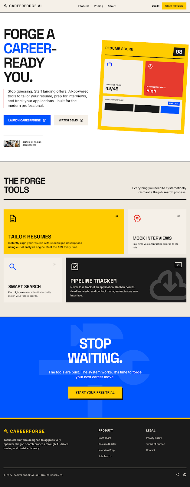
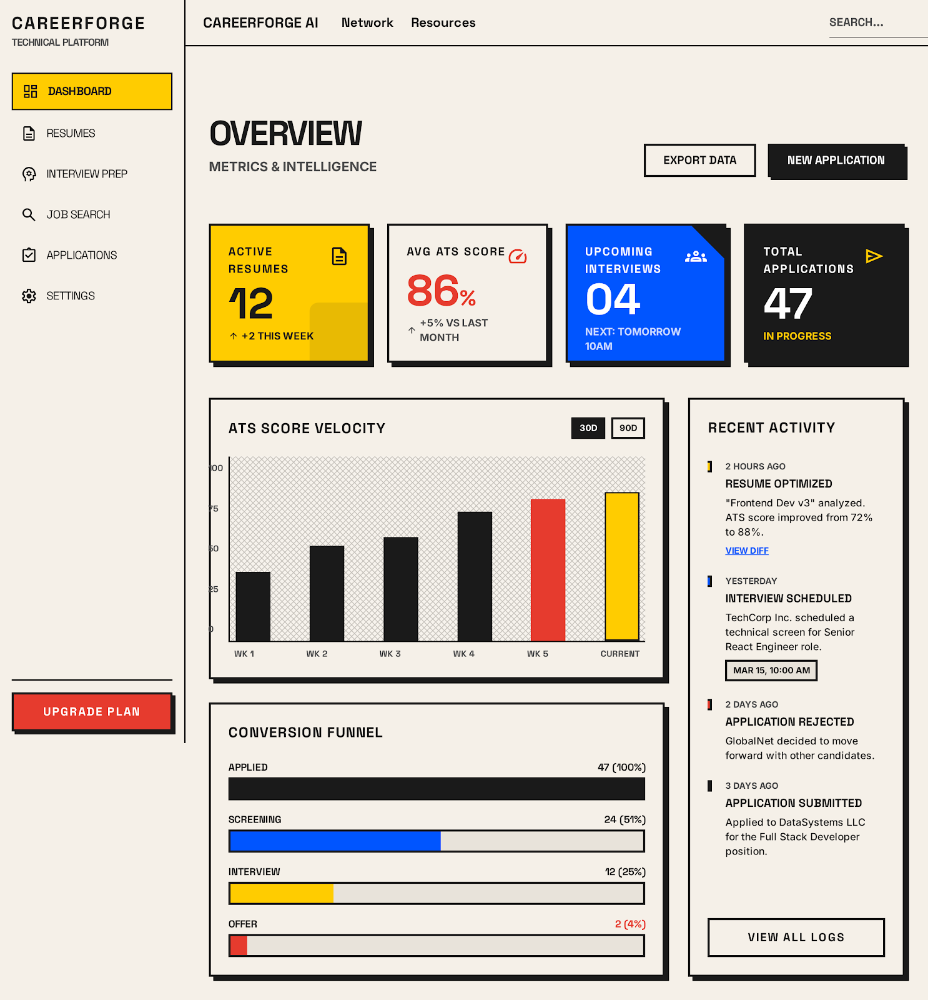
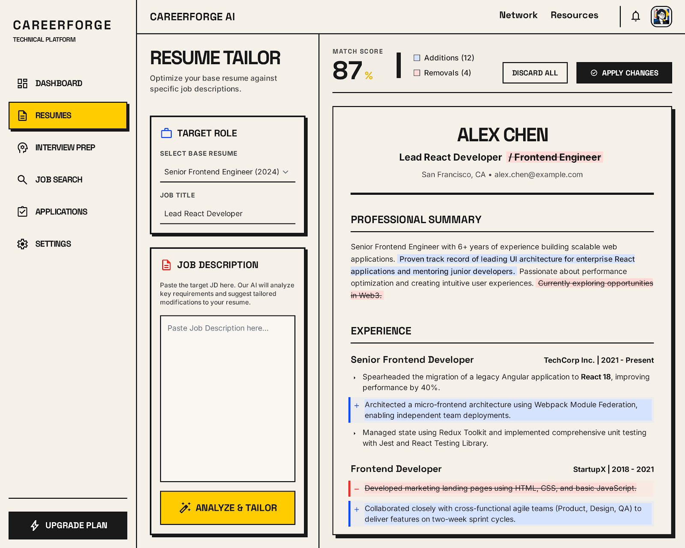
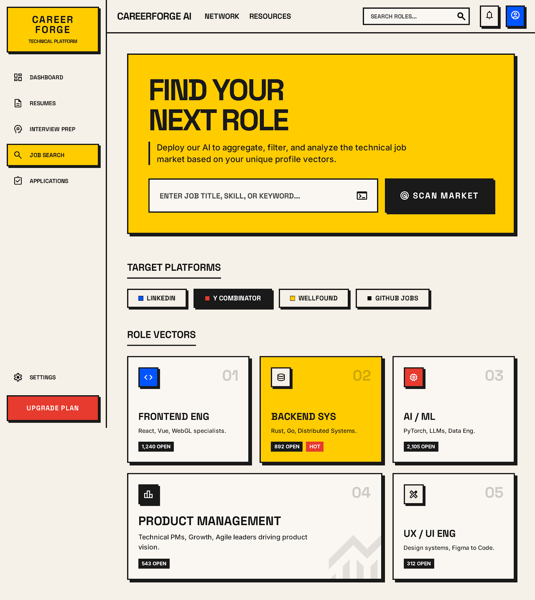
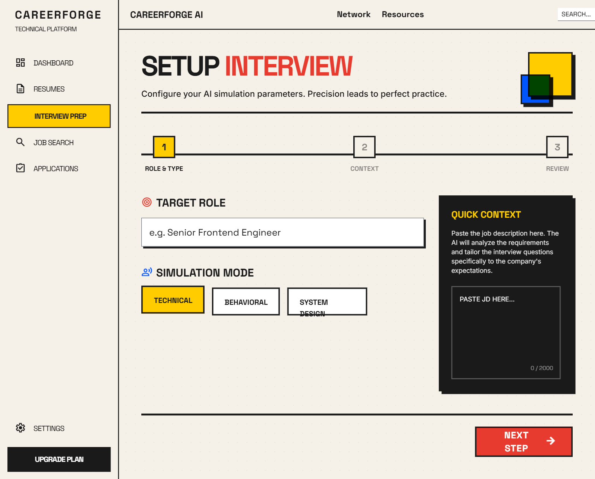
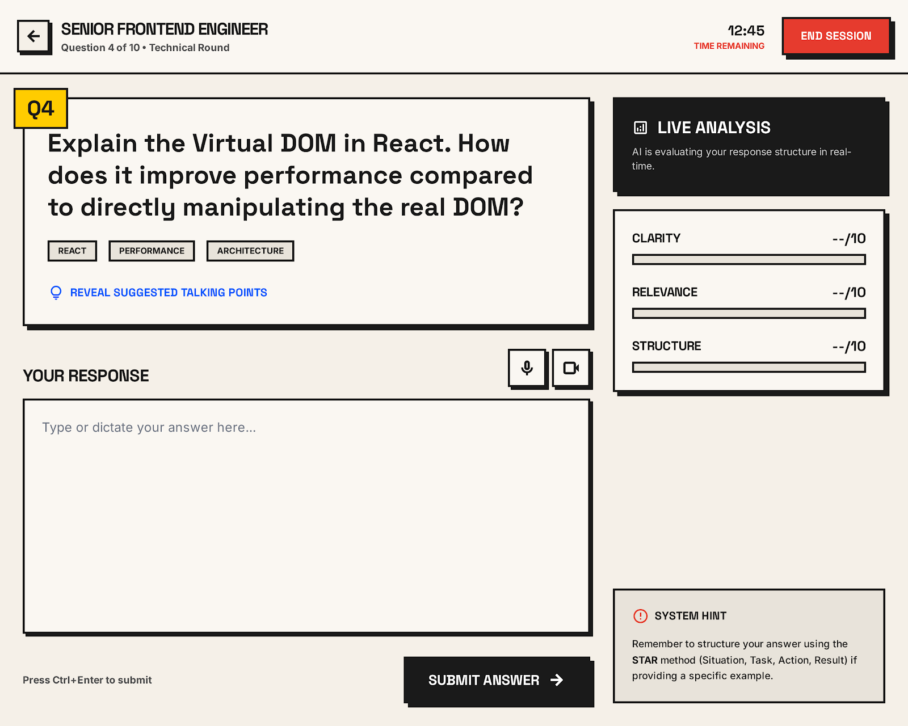
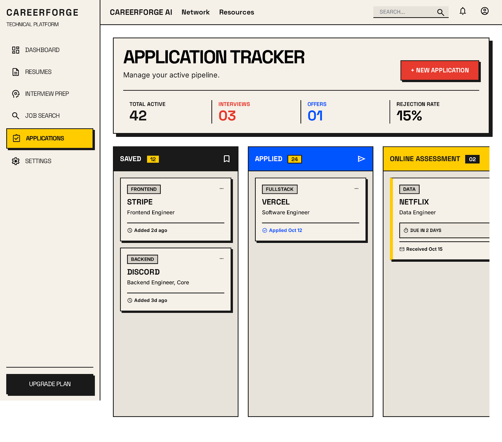
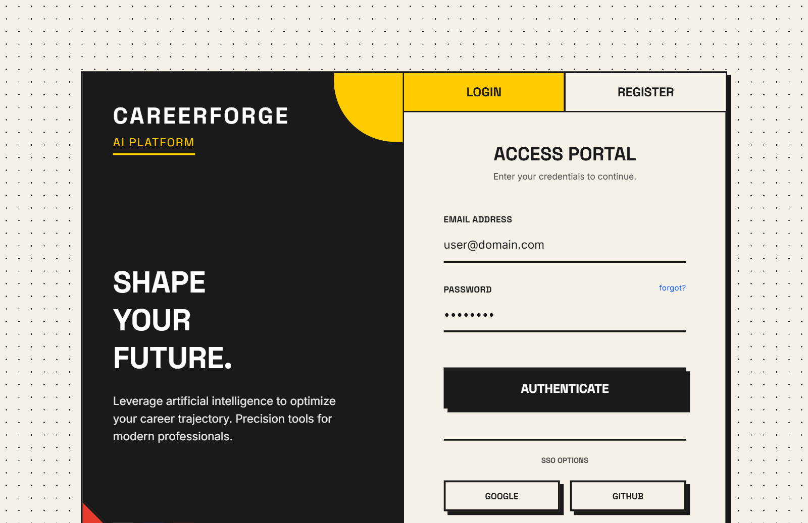
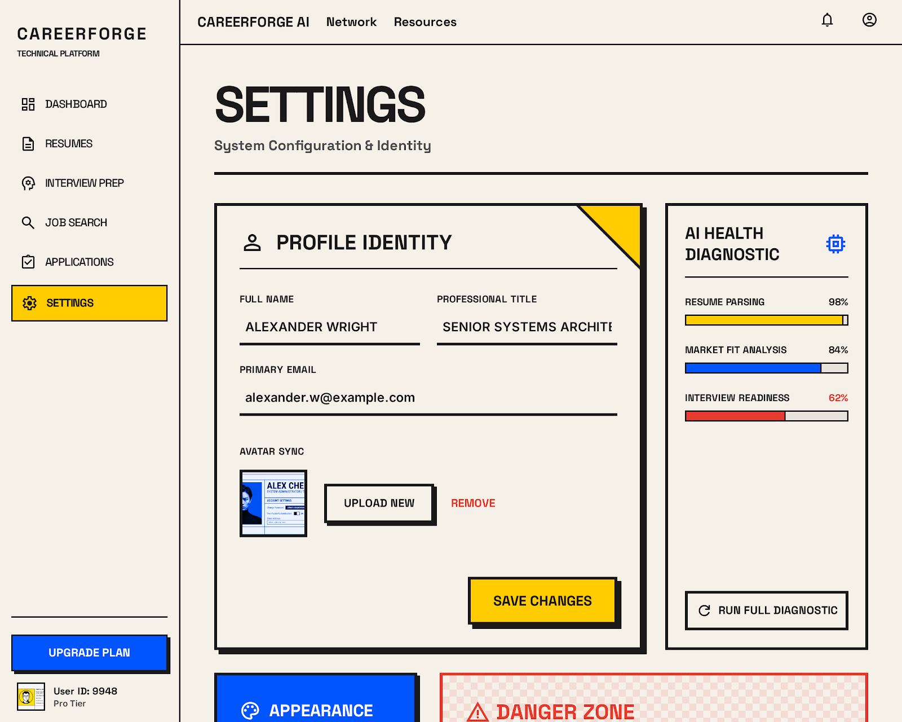

# CareerForge AI

[](https://nextjs.org/)
[](https://expressjs.com/)
[](https://www.mongodb.com/)
[](https://redis.io/)
[](https://openrouter.ai/)
[](https://ai.google/)
[](https://cloudinary.com/)
[](https://firebase.google.com/docs/auth)
[](https://vercel.com/)
[](https://render.com/)

CareerForge AI is a full-stack AI-powered career readiness platform that helps candidates parse resumes, score ATS performance, tailor resumes for target roles, evaluate interview readiness, and manage job applications from one place.

It brings together resume intelligence, AI workflows, and productivity tools in a single, streamlined experience for job seekers.

## 1. Project Name

CareerForge AI

### GitHub Repository

https://github.com/darekarbro/CareerForge-AI

## 2. Problem Statement

Modern job seekers often use multiple disconnected tools to manage the hiring process:

- resume writing happens in one place,
- ATS analysis is done elsewhere,
- job applications are tracked manually,
- interview prep is separate,
- and role tailoring usually requires repetitive manual work.

This fragmentation makes the process slow, inconsistent, and difficult to optimize. CareerForge AI solves this by providing one unified system for resume parsing, ATS scoring, role-specific tailoring, mock interview prep, and application tracking.

## 3. Features

### Core Features

- Resume upload and parsing for PDF, DOCX, and TXT files
- Structured extraction of contact info, skills, work history, education, projects, and certifications
- Editable career profiles and resumes with autosave, revision history and conflict protection
- Repeatable resume quality estimates, separate from job-description match reports
- Per-change tailoring review, manual edits, undo/redo and selected-section rewrites
- Classic, modern and compact resume layouts with actual PDF previews and editable DOCX export
- Saved job workspaces connecting descriptions, resumes, interviews and applications
- Gap analysis against job descriptions to highlight missing skills and recommendations
- Mock interview generation with role-specific questions and evaluation
- Interview history tracking and readiness insights
- Job search hub with curated deep links for external job boards
- Application search, deadlines, follow-up dates, notes and a frozen copy of the resume used
- Interview difficulty, per-question practice timers, delayed feedback, retries and focused follow-up practice
- Guided onboarding, a next-action dashboard and an activity centre for background requests
- Real-time processing events using Socket.IO
- Email/password authentication with JWT, plus Firebase Google Sign-In for social login
- Email verification, password recovery, expiring revocable sessions and sign-out across devices
- Private account export/deletion, supporting-data retention and explicit AI-provider sharing controls
- Firebase-backed Google auth flow: frontend verifies the Google popup, backend validates the ID token via firebase-admin, then issues the app JWT session
- Deterministic fallback engine when AI providers are unavailable

### Bonus Features

- Live agent timeline for processing pipeline visibility
- Resume version history and export management
- Search and application analytics dashboard
- Responsive Bauhaus neo-brutalist UI
- Production-ready Express backend with CORS and rate limiting

## 4. Technology Stack

### Frontend

- Next.js
- React
- Tailwind CSS
- Lucide React icons
- Socket.IO client
- Zustand state management

### Backend

- Node.js
- Express.js
- MongoDB with Mongoose
- Redis with BullMQ
- Socket.IO
- JWT auth with Firebase Authentication Google sign-in integration
- Firebase Admin SDK for Google ID token verification
- Multer uploads

### AI and Cloud Services

- Groq API (primary; configurable model)
- OpenRouter API
- Google Gemini API
- Cloudinary
- Deterministic offline fallback provider

### Dev and Infra Tools

- Vercel
- Render
- Axios
- Helmet
- Express Validator
- CORS
- Compression

## 5. Screenshots

### Landing Page


### Dashboard


### Resume Tailor


### Job Search Hub


### Interview Setup


### Interview Session


### Application Tracker


### Authentication Flow


### Settings View


## 6. Live Demo

### Frontend (Vercel)

https://careerforge-ai-three-eta.vercel.app

### Backend (Render)

https://careerforge-backend-mg0r.onrender.com

## 7. Backend

The backend API is deployed on Render and exposes the application logic for auth, resume processing, ATS analysis, tailoring, gap analysis, interview orchestration, and application tracking.

API health check:

https://careerforge-backend-mg0r.onrender.com/api/health

## 8. Setup Instructions

### Reproducible local setup

Install Docker Desktop (Linux containers), then run from the repository root:

```bash
node scripts/setupLocal.cjs
docker compose --env-file .env.compose up --build -d --wait
```

Open the app at http://localhost:3000 and the local email inbox at http://localhost:8025. Register, open the verification email and confirm your address. Choose allowed AI providers under **Account & privacy** before sending data externally. To use Groq in Docker, add your key to the generated, ignored `.env.compose`; the existing native `server/.env` is not copied into images. Offline processing works without AI keys.

The stack includes a separate API and worker, MongoDB, Redis, Mailpit and the production frontend. Database, queue, originals and local mail use persistent volumes. `docker compose --env-file .env.compose down` stops it without deleting data. See [setup and deployment](docs/DEPLOYMENT.md), [architecture and relationships](docs/ARCHITECTURE.md), [operations runbook](docs/RUNBOOK.md) and [Phase 1 validation](PHASE1.md).

Interactive API documentation is at http://localhost:5000/api/docs and the OpenAPI document at http://localhost:5000/api/openapi.json. CI checks every pull request and retains browser failure screenshots and traces for seven days.

### Prerequisites

- Node.js 24 LTS (recommended; see `.nvmrc`)
- npm
- MongoDB Atlas account or local MongoDB instance
- Redis instance or use fallback mode
- Cloudinary account for production uploads
- A Groq API key for primary AI generation; OpenRouter and Gemini are optional fallbacks

### 1. Clone the repository

```bash
git clone https://github.com/darekarbro/CareerForge-AI.git
cd CareerForge-AI
```

### 2. Install backend dependencies

```bash
cd server
npm install
```

### 3. Configure backend environment variables

Create a `.env` file inside the `server` folder with the required values.

Copy settings from `server/.env.example`. For Groq, set `GROQ_API_KEY` to your own key and keep `GROQ_MODEL=openai/gpt-oss-120b` (or use `openai/gpt-oss-20b` for lower latency). Restart the server after changes. The fallback order is Groq → OpenRouter → Gemini → offline extraction and heuristic scoring. See [environment setup](ENV_SETUP_GUIDE.md).

### 4. Start the backend

```bash
npm run dev
```

The backend runs on:

- http://localhost:5000

### 5. Install frontend dependencies

```bash
cd ../client
npm install
```

### 6. Configure frontend environment variables

Create a `.env.local` file inside the `client` folder and add the required public variables, including the Firebase web config for Google Sign-In.

### 7. Start the frontend

```bash
npm run dev
```

The frontend runs on:

- http://localhost:3000

### 8. Access the app

Open the following URL in the browser:

- http://localhost:3000

## 9. Environment Variables

Do not expose real secret values in GitHub or public repositories.

### Server (`server/.env`)

```env
PORT
NODE_ENV
CLIENT_URL
JWT_SECRET
JOB_PAYLOAD_SECRET
FIREBASE_PROJECT_ID
FIREBASE_CLIENT_EMAIL
FIREBASE_PRIVATE_KEY
MONGODB_URI
GROQ_API_KEY
GROQ_MODEL
GROQ_TIMEOUT_MS
OPENROUTER_API_KEY
OPENROUTER_MODEL
GEMINI_API_KEY
GEMINI_MODEL
AI_PROVIDER_TIMEOUT_MS
CLOUDINARY_CLOUD_NAME
CLOUDINARY_API_KEY
CLOUDINARY_API_SECRET
REDIS_URL
AUTH_RATE_LIMIT_MAX
AI_RATE_LIMIT_MAX
TRUST_PROXY
```

### Client (`client/.env.local`)

```env
NEXT_PUBLIC_API_URL
NEXT_PUBLIC_SOCKET_URL
NEXT_PUBLIC_FIREBASE_API_KEY
NEXT_PUBLIC_FIREBASE_AUTH_DOMAIN
NEXT_PUBLIC_FIREBASE_PROJECT_ID
NEXT_PUBLIC_FIREBASE_STORAGE_BUCKET
NEXT_PUBLIC_FIREBASE_MESSAGING_SENDER_ID
NEXT_PUBLIC_FIREBASE_APP_ID
```

## 10. Deployment Notes

This project is designed for deployment on:

- Vercel for the Next.js frontend
- Render for the Express backend

The frontend and backend should use their deployed URLs in environment variables instead of localhost for production.

Production requires an available `MONGODB_URI` and a private random `JWT_SECRET` of at least 32 characters. Configure exact allowed frontend origins in `CLIENT_URL` and trusted proxy hops/subnets in `TRUST_PROXY` when applicable. Development may use a temporary MongoDB; production fails startup if its database is unavailable.

New uploads are private, and original downloads require ownership. Without Cloudinary, use persistent storage for `server/uploads`. Jobs use Redis when available and otherwise run in a bounded local queue. A MongoDB-backed recovery sweep requeues pending work and expired worker leases after a restart; durable recovery requires a persistent MongoDB database. The temporary development database is discarded when stopped.

Retry inputs are encrypted and expire after the user's selected 1/6/24-hour period. They are removed on success or cancellation. Set a stable private `JOB_PAYLOAD_SECRET`, or use the private `JWT_SECRET` fallback; changing the encryption key makes existing retry inputs unreadable. Commits use job identities to recover existing resume versions, match reports, questions and answer scores without duplicating them. Startup also repairs legacy data inconsistencies; back up a persistent database before deploying. Separate API/worker deployment, SMTP and upgrade instructions are in [the deployment guide](docs/DEPLOYMENT.md).

## Validation

From the repository root, run `npm test`, `npm run lint` and `npm run build`. Tests use synthetic data, isolated local MongoDB/HTTP/WebSocket services and mocked external providers. The frontend tests exercise actual React components in a DOM environment. The build uses Webpack.

For browser acceptance tests, build the frontend with `NEXT_PUBLIC_API_URL=http://localhost:5000/api` and `NEXT_PUBLIC_SOCKET_URL=http://localhost:5000`, then run `npm --prefix client run test:browser`. Leave ports 5000 and 3030 free. The test starts its own API, production frontend and temporary database; it never loads external AI credentials. Set `BROWSER_PATH` to a Chrome/Chromium executable, or install Chromium with `npx playwright install chromium` from `client`. Screenshots and the result summary are written under the ignored `.test-tmp` directory.

See [product improvements and verification](IMPROVEMENTS.md) for the editing, workspace, interview, application, export and recovery workflows.

Resume parsing, tailoring, gap analysis and interview generation/evaluation return HTTP 202 with a processing job ID. The client reconciles live events with persisted job status until a terminal state.

See [the original audit](PROJECT_BUG_AUDIT.md) and [the fixes and verification report](BUG_FIX_REPORT.md) for all 52 resolutions.

Live Groq acceptance checks passed for all six AI actions; see [the live test report](GROQ_LIVE_TEST_REPORT.md). To repeat them with a configured key, run `npm --prefix server run test:groq` using Node 24. This opt-in command sends fictional data to Groq and consumes API quota; normal `npm test` remains offline with respect to external services.

Generated resumes now include a complete preview, detailed source-based summaries and project contributions, grouped skills, and a readable PDF that can span multiple pages. The generator preserves source jobs, projects, skills and stated metrics; sparse entries show suggestions for verified details to add. Groq uses the complete current resume up to 48,000 characters instead of the previous 8,000-character parsing and 6,000-character tailoring slices. Database IDs are omitted from its tailoring input. Other providers keep their previous input limits. Long legacy resumes can be reparsed from their stored source during tailoring; previous versions are preserved.

## Project Summary

CareerForge AI is built to help users modernize their career readiness workflow by combining resume intelligence, ATS scoring, personalized tailoring, interview preparation, and application tracking into a single powerful dashboard.

It is designed for candidates who want a more structured, AI-assisted, and efficient job search process.

## License

This project is intended for educational and portfolio use unless otherwise stated by the repository owner.
