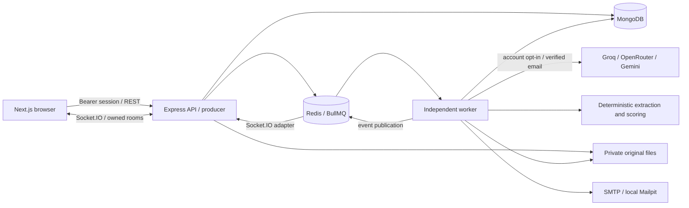
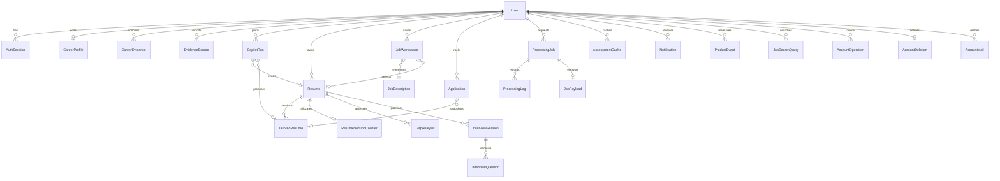
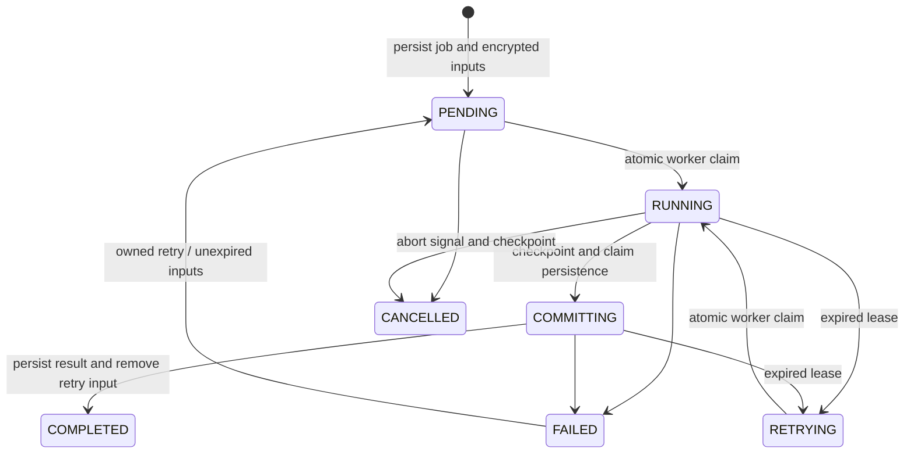

# Architecture and data relationships

CareerForge joins a candidate's verified career facts, job-specific resume versions, interview practice and application history. Node 24 is the supported runtime. The frontend is Next.js; Express owns authorization and domain rules; MongoDB is the durable source of truth. Redis distributes jobs and Socket.IO events. External AI and Cloudinary are optional.

`QUEUE_MODE=producer` never executes jobs in the API process. If Redis is unavailable, accepted work remains PENDING in MongoDB; a worker's recovery sweep can execute it through its bounded local queue. `worker` runs BullMQ consumers, recovery, email delivery, retention and deletion. `combined` runs the API and background services together for native development. Separate processes need the same database, Redis URL, encryption keys and file storage.

The API authenticates every protected request against both its signed JWT and an `AuthSession`. A JWT contains account ID, session ID and account authVersion, plus issuer/audience/expiry. Password reset, password change and sign-out-all increment authVersion, remove sessions and disconnect account sockets. Current-device logout removes just that session. Old unbound JWTs require a new sign-in after upgrading.

When a verified Google identity claims an unverified local registration with the same email, the API atomically replaces the unverified password, links the Google identity and increments authVersion before issuing the new session. Previous sessions and reset/verification tokens are revoked. Already verified local accounts keep their password when linking Google. Password changes compare both the stored password hash and authVersion at write time, so an in-flight request cannot overwrite newer credential state. API responses use `Cache-Control: private, no-store`.

Privacy exports recheck authVersion after credential verification and archive preparation. New deletion requests persist the authorization version; both the API and deletion worker atomically check it before disabling account access. Requests superseded by a credential change are removed without deleting the account. Once deletion is authorized and the account is disabled, recovery can finish it after a process restart. Legacy pending deletion records remain recoverable.

For end-of-session interview feedback, session aggregates, answers, processing outputs, activity messages and workspace summaries hide scores and suggested answers until the session completes. Analytics exclude those incomplete evaluations. Serialization also handles legacy stored processing outputs; full account archives remain complete exports of the account owner's data.

Local registrations queue email verification. Only hashes of 32-byte random verification/reset tokens are stored on User; the outbox temporarily encrypts the delivery payload. Links use the configured APP_URL and a URL fragment, so tokens do not appear in HTTP request paths. Verification expires in 24 hours; reset in 30 minutes. Atomic consumption prevents two successful uses. Reset also checks the authVersion present when the token was created. Recovery and resend responses are generic, with a database-backed one-minute address/kind cooldown and IP limits. SMTP failures retry up to five times; outbox payloads expire after one hour and are removed after successful delivery.

## Collections

Most domain records carry `owner` and all reads/mutations filter by it. InterviewQuestion ownership comes through its session. ResumeVersionCounter is keyed by resume ID. AccountMail uses a keyed email hash so unknown-address recovery requests receive the same treatment without storing plain recipient addresses. WorkerHeartbeat contains a random worker ID and timestamps, without candidate content.

CareerEvidence stores stable fact identities, revisions, source quotes, verification and measurement states. Entry context includes both source record ID and stable entry ID, so legacy IDs repeated across resumes cannot share project evidence. EvidenceSource holds locally extracted document text or bounded public GitHub metadata/README previews. Selection and personal-contribution confirmation precede library insertion; unconfirmed previews expire after 24 hours. CopilotRun stores bounded conditional planning, questions, confirmed/skipped answers, retrieved fact snapshots and review outcomes. It uses the existing `resume_copilot` job lifecycle; recovered commits reuse the saved version.

TailoredResume carries evidence snapshots and per-claim results. Generated claims are checked against the specific source entry and confirmed, scoped additions before persistence. Unsupported known claims are withheld from output; rechecking citations consults current verification without silently rewriting saved manual edits. Structured term ranking replaces the need for embeddings at the bounded library size. These checks and citations aid review; they do not establish semantic truth or external authorship. See the [workflow and limits](PHASE3_WORKFLOWS.md).

Resume source revisions and reviewed version revisions use optimistic concurrency: stale clients receive HTTP 409. Profile facts and explicit resume edits are authoritative. Tailoring proposes changes without inventing employers, metrics, qualifications or technologies. Application resume snapshots preserve the exact reviewed content submitted, even if the source version changes later. These manual facts are kept until explicitly deleted; supporting activity has separate retention limits.

## Processing lifecycle

Every job is persisted before dispatch. MongoDB atomically claims it; duplicate Redis deliveries and recovery dispatches do not execute it twice. A 90-second lease renews every 10 seconds. Recovery runs at startup and every 30 seconds, with bounded attempts. Results use processingJobId and score-map identities so recovered commits reuse existing records. Cancellation returns 409 once COMMITTING begins. A separate execution lease lasts through final event/notification writes, allowing account deletion to drain a cancelled or completed worker safely.

JobPayload encrypts temporary inputs with AES-256-GCM and owner/job authenticated context. Successful/cancelled work removes its payload. Failed requests can retry within the chosen 1/6/24-hour period. Changing encryption keys invalidates existing encrypted inputs. Processing logs and usage metadata exclude raw prompts and tokens.

## Privacy and deletion

External AI starts disabled per account. The worker checks provider permission again before each provider attempt, including fallbacks. The selected provider and model form part of assessment cache identity; changing preferences clears owned caches. Already submitted requests can finish. Groq may receive complete source text within its configured limits; other providers retain their smaller input limits. Deterministic processing makes no AI-provider calls. Provider health means configured, not a successful live request.

Retention settings cover completed processing history/logs, notifications and export events (30/90/365 days), cached assessments (1/7/30 days), and encrypted retry inputs (1/6/24 hours). Lowering a period removes eligible supporting records immediately; a worker sweep runs every 15 minutes. MongoDB TTL indexes are additional cleanup, not the access-control boundary. Profiles, resumes, interview results and applications remain until deleted.

Export reauthenticates and returns owned JSON records plus optional private originals. It excludes passwords, session JWTs, reset/verification material, encryption payloads and internal file paths. It limits originals to 50 MB and total uncompressed contents to 70 MB; larger archives need individual original downloads or a records-only export.

Deletion requires password or fresh matching Google proof plus the literal DELETE. A durable request is created before access is disabled. AccountOperation leases let in-flight HTTP handlers finish, even after a client disconnects. The worker cancels pending/running jobs, waits for active request/execution/commit leases, refreshes and persists the original-file manifest, removes files and all owned/derived records, then removes User. File failure keeps the request retrying; it never reports completion while an original could remain. A crash can replay deletion safely. The receipt is hashed; completed requests retain only completion timestamps and the receipt hash for seven days, with owner/email/file links removed.

Database backups, already delivered emails and data already submitted to external providers follow the operator/provider's retention policies. Restoring backups requires replaying outstanding deletion requests before reopening traffic; see the runbook. The app does not claim it can recall already submitted third-party data.
