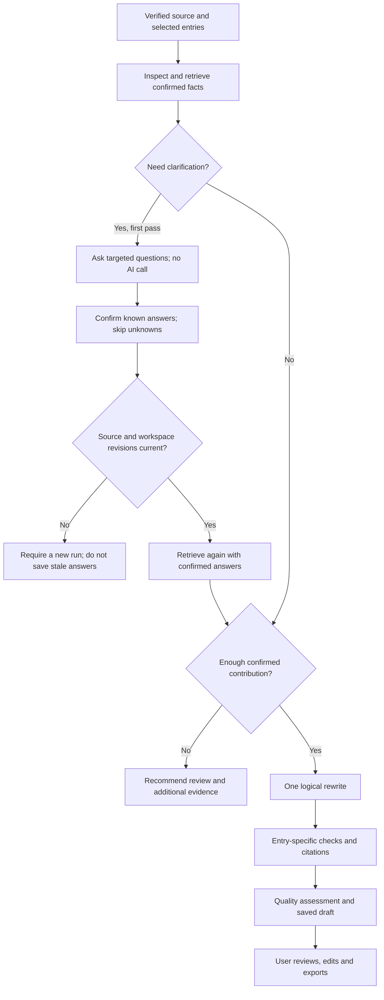

# Career evidence and resume copilot

Phase 3 adds a structured evidence library, inspectable claim citations and a bounded resume-writing workflow. The planner uses explicit application rules and conditions. The AI provider rewrites and assesses wording; it does not choose arbitrary tools or run repository instructions.

## Build a library

Open **Evidence library** from the sidebar. Collect a ready resume, collect your saved career profile, or add an achievement, responsibility, project or skill yourself. Each fact has a stable ID, optimistic revision, original source passage, verification state and measurement state.

- **Unverified** means the fact still needs checking. Saved profile facts start here.
- **Confirmed** records your assertion about your own work. New facts from an already verified resume inherit its confirmation. It does not certify authorship or establish external truth.
- **Rejected** and archived facts are excluded from retrieval. Repeated collection never resets your decisions or overwrites an edited fact.
- **Unknown**, **reported** and **measured** distinguish missing measurement context from a stated result. A measured result needs notes describing its method; notes are still user supplied.

Collection is idempotent. If facts were collected before you verified the source resume, confirm those existing facts in the library; collecting again preserves their states. Unchanged facts keep their IDs after entries move. Source passage locations describe the collection revision, rather than the current position after a reorder.

Link an entry-specific fact to its **specific resume or profile entry**. Source record ID plus stable entry ID prevents legacy entry-ID collisions from joining unrelated projects. Facts do not automatically transfer between separate source records, including resumes derived from a profile. Edit the context deliberately when reusing a fact. General library facts can be found in library search, but do not enrich an unrelated experience or project.

## Import project evidence

Expand **Import a project from GitHub or a document**. Public GitHub import requires an HTTPS `github.com/owner/repository` URL and confirmation that it is your repository. It reads bounded repository metadata, README and language information through GitHub's public API. No GitHub credential, OAuth verification or private-repository access is used. Public API quota or access errors offer retry or document upload.

Alternatively, upload your own PDF, DOCX or UTF-8 TXT project document. Extraction happens locally. The original document bytes are not retained; extracted source text is retained with the preview. Neither preview path sends the source to an AI provider.

Inspect the original text, select individual passages, rewrite them as your **own contribution**, edit the suggested technologies to those you personally used, and explicitly confirm. A repository's languages or a team's README do not prove your contribution. Ordinary project facts can be imported; obvious instruction-like passages are refused. This filter is a heuristic, not a general prompt-injection guarantee. Source content is always treated as data by provider instructions.

Only selected passages enter the library, as confirmed facts linked to the chosen context. Their original passage and source URL remain inspectable even after the statement is edited. Confirmation is revision checked and single use. Discard an unused preview; unconfirmed previews expire after 24 hours. Confirmed sources support citations and cannot be discarded independently: archive their facts to stop retrieval, or use full account deletion to remove source records.

## Run the copilot

1. Verify and save your source resume. Confirm any earlier unverified library facts needed by the selected scope.
2. Open **Resume copilot**, choose the source, target role, optional job description and whole-resume, summary or single-entry scope. A job workspace supplies its saved inputs and selected entries.
3. The planner inspects the frozen source and retrieves confirmed, owner-scoped facts. It asks at most eight focused questions when personal contribution or measurement context is missing. Initial clarification makes no AI call.
4. Supply only known facts and explicitly confirm them. Blank answers and answers such as “unknown” stay empty. Skipped personal-contribution questions may end in a review recommendation without generation. Clarification can continue once; there is no automatic questioning loop.
5. If sufficient confirmed detail is available, the worker generates one logical rewrite, checks claims and performs one quality assessment. Only the selected section or entry is replaced. The original profile and resume remain unchanged.
6. Inspect the action trace and retrieved facts. Open **Review draft and its evidence**, decide which suggestions to keep, save and export.

There are at most eight recorded planning steps across the initial and continued run. Provider fallback and bounded format correction can involve additional HTTP requests. Groq can make one factual correction when a rewrite fails detail preservation; the replacement must pass the same validation. A correction is not accepted just because it is valid JSON. Quota and authentication errors do not trigger format correction. The workflow is bounded conditional planning, rather than an open-ended autonomous agent.



Queued runs use the existing owner checks, provider-sharing preferences, encrypted retry inputs, cancellation checkpoints and durable worker recovery. A recovered commit reconnects its saved version instead of generating a duplicate. Changing source or workspace inputs before clarification continues returns a conflict before saving new facts. Failed/cancelled jobs can be inspected in Activity.

## Inspect a claim

Expand **Evidence behind this resume** on a tailored version. Each summary, project description and experience/project bullet shows matching evidence IDs, source quotes, verification states and measurement notes. Newly generated versions store snapshots; older versions can collect source evidence explicitly.

Known quantities, technologies, implementation mechanisms and selected responsibilities are checked against that particular experience or project. A skill or number in another entry is insufficient. Common decimal formats, several Unicode digit sets and quantity/unit changes are covered. Unsupported generated wording is replaced with source wording or omitted and retained separately as a withheld suggestion. Manual edits are checked and flagged when the panel is refreshed; they are not silently rewritten.

Rechecking uses current library verification. Rejected, archived, deleted, edited or moved evidence loses its earlier eligibility. A statement can therefore need confirmation after its supporting evidence changes. Existing saved resume content and application snapshots remain reviewable; rechecking does not silently rewrite a past application.

Checks are conservative heuristics. Lexical citations can be relevant without proving complete semantic entailment. They do not prove authorship, validate every possible technology or detect every invented claim. Review meaning, causal relationships and scope before using a resume. A resume quality estimate is a writing aid, not an employer's ATS result.

## Bounds and retention

- A library allows 4,000 active facts, with 50 records per page. Collection takes at most 500 facts from one source snapshot.
- Retrieval ranks normalized matching terms within owned confirmed facts, returning up to 24 library matches or 30 copilot matches. Copilot relevance uses up to 80 terms/1,500 characters; the full permitted source and job description still follow the provider's existing input rules. There is no embedding service or vector database in this phase.
- Previews accept existing 10 MB upload limits and at most 48,000 extracted characters; up to 40 candidate passages are shown. Large sources require a smaller relevant excerpt, not silent truncation into an asserted fact.
- Confirmed facts longer than an editable bullet limit are retained in the library but not automatically inserted as bullets. An over-limit combined resume ends with a review recommendation.
- Facts, confirmed source records and copilot decisions are durable career records. The processing activity/log retention setting applies to supporting job records, not these saved career records. Account export includes all three new collections; full deletion removes them.
- Deleting a source resume removes its automatically collected evidence and copilot runs. Independently confirmed manual/imported facts remain reusable library records until archived or the account is deleted. Relink them before using them with a different source.

## Reproduce validation

Use Node 24. Existing `npm test` commands in `server` and `client`, client lint/build and `npm run test:browser` include Phase 3. The browser journey runs an isolated database and fictional account with deterministic responses. CI retains screenshots and accessibility evidence for seven days. `node scripts/testCompose.cjs` also covers the separate worker, scoped copilot, imports, citations and revocation.

The explicit live command below consumes Groq quota, disables fallback, uses fictional career data and a temporary database. The optional public-repository preview is fetched only for inspection and discarded without AI sharing. Omit that argument to skip GitHub network access.

```powershell
node server/scripts/testGroqLive.js --live --evidence --public-repo=darekarbro/CareerForge-AI
```

Safe live metrics are written to `.test-tmp/groq-evidence-results.json`; synthetic PDF/browser evidence and temporary databases are ignored by Git. See [Phase 3 results](../PHASE3.md) and the [dependency audit](DEPENDENCY_AUDIT.md) for the final validation scope and remaining upstream advisories.
